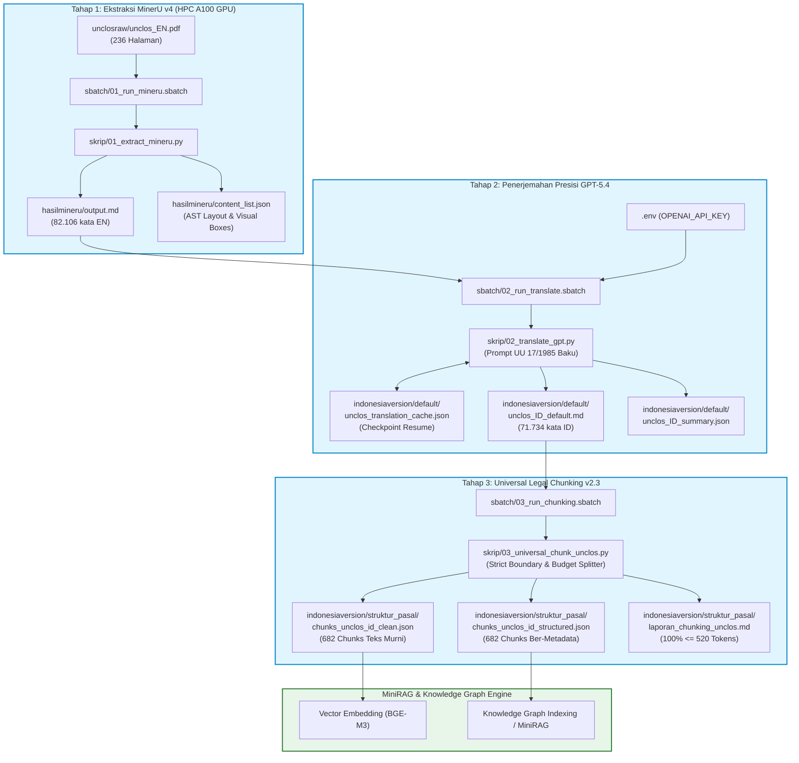

# 8_UNCLOS: Pipeline Ekstraksi, Penerjemahan Hukum Maritim Baku, dan Universal Legal Chunking (UNCLOS 1982)

Dokumentasi arsitektur, spesifikasi teknis, dan panduan operasional modul `8_unclos/`. Modul ini bertanggung jawab atas pemrosesan naskah traktat internasional **United Nations Convention on the Law of the Sea 1982 (UNCLOS 1982)** — yang telah diratifikasi oleh Pemerintah Republik Indonesia melalui **Undang-Undang Nomor 17 Tahun 1985**.

Pipeline ini dirancang modular dalam 3 tahapan mandiri (*decoupled pipeline*) dengan dukungan komputasi performa tinggi (**HPC BRIN Mahameru-AI / GPU NVIDIA A100**), mesin penerjemah LLM (**OpenAI GPT-5.4**), serta pemotongan naskah berbasis semantik hukum (**Universal Legal Chunker v2.3** berkuota ketat $\le 520$ token).

---

## 1. Peta Struktur Direktori Kerja (`8_unclos/`)

Berikut adalah struktur lengkap berkas dan direktori yang terdapat pada modul `8_unclos/`:

```text
8_unclos/
├── .env                              # [Diabaikan Git - Aman] Berisi OpenAI API key & konfigurasi model
├── .env.example                      # [Tracked] Template variabel lingkungan untuk replikasi publik
├── PLAN_EKSTRAKSI_DAN_TRANSLATE_UNCLOS.md # Rencana kerja operasional dan catatan teknis pelaksanaan
├── README.md                         # Dokumentasi teknis arsitektur & panduan eksekusi (berkas ini)
├── sync_to_hpc.sh                    # Skrip sinkronisasi lokal -> HPC (mahoni01)
├── sync_from_hpc.sh                  # Skrip sinkronisasi HPC -> lokal
│
├── unclosraw/
│   └── unclos_EN.pdf                 # Dokumen asli UNCLOS 1982 versi bahasa Inggris (236 halaman)
│
├── hasilmineru/                      # [Tahap 1] Artefak hasil ekstraksi MinerU v4 di HPC
│   ├── output.md                     # Naskah bersih Markdown bahasa Inggris (82.106 kata)
│   ├── content_list.json             # Struktur AST & bounding box visual dokumen
│   └── origin.pdf                    # Salinan naskah sumber PDF dari proses ekstraksi
│
├── indonesiaversion/
│   ├── default/                      # [Tahap 2] Naskah terjemahan resmi standar UU No. 17/1985
│   │   ├── unclos_ID_default.md      # Naskah utuh bahasa Indonesia (71.734 kata hukum)
│   │   ├── unclos_ID_summary.json    # Ringkasan metrik keberhasilan penerjemahan (524 segmen)
│   │   └── unclos_translation_cache.json  # [Diabaikan Git] Cache checkpoint per pasal anti-gagal
│   │
│   └── struktur_pasal/               # [Tahap 3] Hasil Universal Legal Chunker v2.3 (<= 520 token)
│       ├── chunks_unclos_id_clean.json       # Array 682 teks chunk bersih siap embedding MiniRAG
│       ├── chunks_unclos_id_structured.json  # Array 682 chunk lengkap dengan metadata hierarki
│       └── laporan_chunking_unclos.md        # Laporan audit kepatuhan kuota token (100% compliant)
│
├── sbatch/                           # Skrip batch job SLURM untuk eksekusi di HPC BRIN
│   ├── 01_run_mineru.sbatch          # Eksekusi MinerU A100 GPU (Tahap 1)
│   ├── 02_run_translate.sbatch       # Eksekusi Penerjemahan GPT-5.4 (Tahap 2)
│   └── 03_run_chunking.sbatch        # Eksekusi Universal Chunking CPU (Tahap 3)
│
└── skrip/                            # Engine logika komputasi Python
    ├── 01_extract_mineru.py          # Logika windowed batching ekstraksi MinerU v4
    ├── 02_translate_gpt.py           # Engine penerjemah Async + Semaphore + Checkpoint Resume
    └── 03_universal_chunk_unclos.py  # Engine Universal Legal Chunker v2.3 (Rule-based & Header Context)
```

---

## 2. Penjelasan Komponen Berkas & Direktori

### 2.1. Berkas Konfigurasi, Keamanan, & Sinkronisasi
| Berkas | Fungsi & Penjelasan |
| :--- | :--- |
| **`.env`** | Berkas rahasia lokal/remote yang menyimpan kredensial `OPENAI_API_KEY`, `OPENAI_BASE_URL`, dan `OPENAI_MODEL`. Berkas ini **wajib diabaikan oleh Git** (`.gitignore`) demi mencegah kebocoran kunci API publik. |
| **`.env.example`** | Berkas template publik berisi parameter yang diperlukan tanpa membocorkan nilai kredensial sensitif. Digunakan sebagai acuan ketika modul di-clone ke lingkungan baru. |
| **`PLAN_EKSTRAKSI_DAN_TRANSLATE_UNCLOS.md`** | Dokumen panduan langkah demi langkah dan strategi mitigasi kendala operasional SLURM di HPC. |
| **`sync_to_hpc.sh`** | Skrip Bash untuk menyinkronkan berkas skrip, dataset, dan konfigurasi dari laptop lokal ke direktori kerja HPC BRIN (`mahoni01:~/projek-legal-rag/8_unclos/`). |
| **`sync_from_hpc.sh`** | Skrip Bash untuk menarik seluruh artefak hasil komputasi dari HPC ke mesin lokal secara selektif tanpa menimpa berkas konfigurasi lokal. |

### 2.2. Folder Data Sumber (`unclosraw/`)
| Berkas | Deskripsi |
| :--- | :--- |
| **`unclos_EN.pdf`** | Dokumen sumber resmi naskah *United Nations Convention on the Law of the Sea (UNCLOS 1982)* setebal 236 halaman berbahasa Inggris. Dokumen ini mencakup Pembukaan (*Preamble*), Bagian I s.d. Bagian XVII (320 Pasal), serta 9 Lampiran (*Annexes*). |

### 2.3. Tahap 1: Ekstraksi OCR/VLM MinerU v4 (`hasilmineru/`)
Dijalankan pada GPU NVIDIA A100 melalui `sbatch/01_run_mineru.sbatch` dan engine `skrip/01_extract_mineru.py`.
- **`output.md`**: Teks lengkap Markdown hasil ekstraksi tata letak multi-kolom, formula, dan tabel dari naskah PDF asli tanpa sampah visual/base64 (5.573 baris, 82.106 kata).
- **`content_list.json`**: Struktur Abstract Syntax Tree (AST) dan koordinat bounding box setiap elemen paragraf, judul, dan tabel yang diekstrak oleh model vision-language MinerU.
- **`origin.pdf`**: Salinan verifikasi naskah asli PDF yang diproses oleh engine MinerU.

### 2.4. Tahap 2: Penerjemahan Presisi Standar UU No. 17/1985 (`indonesiaversion/default/`)
Dijalankan melalui `sbatch/02_run_translate.sbatch` dan engine `skrip/02_translate_gpt.py` menggunakan OpenAI API (`gpt-5.4`).
- **`unclos_ID_default.md`**: Naskah lengkap hasil terjemahan hukum maritim resmi Indonesia. Menjaga struktur Bagian I s.d. Bagian XVII dan Lampiran I s.d. Lampiran IX secara utuh.
- **`unclos_ID_summary.json`**: Metadata statistik penerjemahan: 524 segmen diproses, 524 segmen berhasil (0 kegagalan), total 71.734 kata bahasa Indonesia.
- **`unclos_translation_cache.json`**: Berkas checkpoint lokal (diabaikan git). Setiap segmen yang berhasil diterjemahkan langsung disimpan ke cache ini. Jika terjadi gangguan jaringan atau batas waktu SLURM (*walltime timeout*), proses dapat dilanjutkan (*resume*) tanpa perlu menerjemahkan ulang segmen yang sudah selesai.

### 2.5. Tahap 3: Universal Legal Chunking v2.3 (`indonesiaversion/struktur_pasal/`)
Dijalankan melalui `sbatch/03_run_chunking.sbatch` dan engine `skrip/03_universal_chunk_unclos.py`.
- **`chunks_unclos_id_clean.json`**: Array 682 teks murni dengan header kontekstual standar (`UNCLOS 1982 | Bagian ... | Seksi ... | Pasal ...`). Berkas ini dioptimalkan khusus sebagai input langsung proses pembuatan embedding vektor (MiniRAG / BGE-M3).
- **`chunks_unclos_id_structured.json`**: Kumpulan 682 chunk berformat JSON kaya yang memuat metadata hierarkis: `chunk_id`, `doc_id`, `bagian`, `seksi`, `pasal`, `judul_pasal`, `category`, `tokens`, dan `content`. Sangat cocok untuk *hybrid search*, pembuatan Knowledge Graph, dan penautan relasi regulasi.
- **`laporan_chunking_unclos.md`**: Laporan audit otomatis yang mencatat metrik batas token, distribusi panjang chunk, dan membuktikan 100% chunk berada pada ambang $\le 520$ token.

### 2.6. Direktori Skrip & Job SLURM (`skrip/` & `sbatch/`)
- **`skrip/01_extract_mineru.py`**: Mengelola pembagian batch jendela 64-halaman (hybrid windowing) pada MinerU v4 untuk mencegah *Out-of-Memory* (OOM) pada dokumen tebal.
- **`skrip/02_translate_gpt.py`**: Parser berbasis regex yang membagi naskah Markdown menjadi 524 segmen logis (Preamble, per-Pasal, per-Lampiran), memanggil API GPT-5.4 secara asinkron dengan pembatasan *concurrency* (*semaphore*), serta mengimplementasikan *retry mechanism with exponential backoff*.
- **`skrip/03_universal_chunk_unclos.py`**: Implementasi *Universal Legal Chunker v2.3*. Menerapkan *strict boundary* pada pergantian pasal, preservasi *header context*, dan mekanisme *split-by-line fallback* untuk teks daftar/mukadimah yang padat.
- **`sbatch/01_run_mineru.sbatch`**: Job script SLURM untuk ekstraksi GPU A100 (partisi GPU Mahameru-AI).
- **`sbatch/02_run_translate.sbatch`**: Job script SLURM untuk penerjemahan GPT-5.4 (partisi CPU/komputasi Mahameru-AI).
- **`sbatch/03_run_chunking.sbatch`**: Job script SLURM untuk chunking struktur pasal (proses CPU berkecepatan tinggi).

---

## 3. Diagram Alur Pipeline End-to-End



---

## 4. Standar Terminologi Hukum Maritim (UU No. 17 Tahun 1985)

Untuk memastikan akurasi hukum internasional yang selaras dengan naskah ratifikasi Indonesia, `skrip/02_translate_gpt.py` disematkan leksikon resmi:

| Naskah Asli (UNCLOS 1982) | Terjemahan Baku Resmi Indonesia |
| :--- | :--- |
| **Preamble** | Mukadimah |
| **Part** | Bagian |
| **Section** | Seksi |
| **Article** | Pasal |
| **Paragraph** | Ayat |
| **Territorial Sea** | Laut Teritorial |
| **Contiguous Zone** | Zona Tambahan |
| **Exclusive Economic Zone (EEZ)** | Zona Ekonomi Eksklusif (ZEE) |
| **Continental Shelf** | Landas Kontinen |
| **High Seas** | Laut Lepas |
| **The Area** | Kawasan (Dasar Laut Internasional) |
| **International Seabed Authority** | Otoritas Dasar Laut Internasional |
| **Archipelagic State** | Negara Kepulauan |
| **Archipelagic Waters** | Perairan Kepulauan |
| **Internal Waters** | Perairan Pedalaman |
| **Innocent Passage** | Hak Lintas Damai |
| **Transit Passage** | Hak Lintas Transit |
| **Archipelagic Sea Lanes Passage** | Hak Lintas Alur Laut Kepulauan |
| **Living Resources** | Sumber Daya Hayati |
| **Non-living Resources** | Sumber Daya Non-Hayati |
| **Land-locked States** | Negara Tanpa Pantai |
| **Enterprise** | Perusahaan (*The Enterprise*) |

---

## 5. Panduan Operasional & Eksekusi

### 5.1. Persiapan Lingkungan & Kredensial
Salin berkas `.env.example` menjadi `.env` lalu masukkan API Key OpenAI Anda:
```bash
cp .env.example .env
nano .env
```
Pastikan variabel terisi:
```env
OPENAI_API_KEY=sk-proj-xxxxxxxxxxxxxxxxxxxxxxxxxxxxxxxx
OPENAI_BASE_URL=https://api.openai.com/v1
OPENAI_MODEL=gpt-5.4
REQUEST_CONCURRENCY=4
```

### 5.2. Sinkronisasi ke Klaster HPC Mahameru-AI
Kirim direktori kerja ke HPC:
```bash
./sync_to_hpc.sh
```

### 5.3. Eksekusi Mandiri Bertahap di HPC
Masuk ke klaster HPC:
```bash
ssh mahoni01
cd ~/projek-legal-rag/8_unclos
```

Jalankan tiap tahap secara berurutan dan pantau progresnya:

1. **Jalankan Tahap 1 (Ekstraksi MinerU v4 pada GPU A100):**
   ```bash
   sbatch sbatch/01_run_mineru.sbatch
   # Pantau log
   tail -f unclos_mineru_*.log
   ```

2. **Jalankan Tahap 2 (Penerjemahan GPT-5.4):**
   ```bash
   sbatch sbatch/02_run_translate.sbatch
   # Pantau log
   tail -f unclos_translate_*.log
   ```
   > [!TIP]
   > Jika job terhenti karena *walltime limit*, jalankan kembali perintah di atas. Skrip otomatis melanjutkan dari titik terakhir tanpa mengulang segmen yang sudah selesai.

3. **Jalankan Tahap 3 (Universal Legal Chunking v2.3):**
   ```bash
   sbatch sbatch/03_run_chunking.sbatch
   # Pantau log (selesai dalam beberapa detik)
   cat unclos_chunking_*.log
   ```

### 5.4. Pengambilan Hasil ke Mesin Lokal
Dari terminal komputer lokal Anda:
```bash
cd /home/chandreu/brin-2026/pengujian-komparasi-minirag/8_unclos
./sync_from_hpc.sh
```

---

## 6. Ringkasan Metrik Hasil Akhir (*Audit Benchmarks*)

| Parameter Audit | Nilai Capaian | Status / Keterangan |
| :--- | :--- | :--- |
| **Dokumen Sumber** | UNCLOS 1982 (236 Halaman PDF) | Berhasil dimuat dan diproses utuh |
| **Hasil Ekstraksi MinerU** | 82.106 kata bahasa Inggris | 5.573 baris Markdown bersih |
| **Segmen Diterjemahkan** | 524 / 524 segmen (100%) | 0 segmen gagal, model `gpt-5.4` |
| **Total Kata Bahasa Indonesia**| 71.734 kata hukum baku | Mengacu leksikon UU No. 17/1985 |
| **Total Chunks Dihasilkan** | 682 chunk potongan regulasi | Meliputi Mukadimah, 320 Pasal, & 9 Lampiran |
| **Pasal Unik Terpetakan** | 475 pasal / butir regulasi | Termasuk pasal-pasal Lampiran (*Annexes*) |
| **Rata-rata Tokens / Chunk** | 269 tokens | Distribusi seimbang untuk embedding |
| **Ukuran Chunk Minimum** | 23 tokens | Judul pasal ringkas atau klausa pembuka |
| **Ukuran Chunk Maksimum** | 520 tokens | **Batas absolut: 520 tokens** |
| **Kepatuhan Token Budget** | **100% Lulus ($\le 520$ tokens)**| **Nol pelanggaran kuota token** |
| **Keamanan Kredensial** | `.env` diabaikan oleh Git | Sesuai kaidah keamanan repositori |
